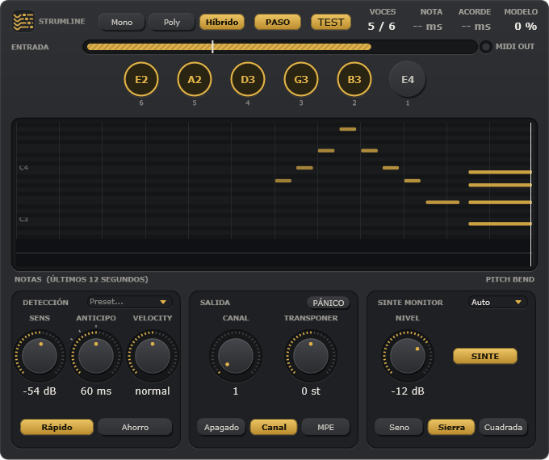

# Strumline

[English](README.md) · **Español**

**Plugin libre y de código abierto de guitarra a MIDI (VST3 y aplicación independiente) para Windows, Linux y macOS.** Escucha una guitarra eléctrica común, sin pastilla hexafónica, y toca lo que oye (notas sueltas y acordes, en tiempo real) como MIDI, para tocar sintetizadores en vivo o grabar MIDI en el DAW. Conversión de audio a MIDI y detección de altura polifónica, hecha con C++20, [JUCE](https://juce.com) y [Basic Pitch](https://github.com/spotify/basic-pitch) por ONNX Runtime.

[Descargar](https://github.com/nicolasquijano/Strumline/releases) · [Plan y resultados](docs/PLAN_GUITAR_MIDI.md) · [Changelog](CHANGELOG.md)

Palabras clave: guitarra a MIDI, convertidor de guitarra a MIDI, audio a MIDI, detección de altura polifónica, sinte de guitarra, MIDI de guitarra sin pastilla hexafónica, VST3, JUCE, Basic Pitch, ONNX Runtime.



## Qué hace

- **Una nota** (convertidor rápido): la nota sale unos 30 a 40 ms después de la púa, con pitch bend y un afinador en cents.
- **Acordes** (el modelo Basic Pitch de Spotify, por ONNX Runtime, en un hilo propio): unos 80 a 100 ms desde el ataque, hasta 6 notas a la vez.
- **Tres modos:** *Mono* (una nota a la vez, lo más rápido), *Poly* (acordes, lo más exacto) e *Hybrid* (la primera nota rápido y el resto del acorde después).
- Salida MIDI con canal, transposición, curva de velocity y pitch bend; un sinte de monitoreo (seno, sierra, cuadrada) para oír la conversión sin otro instrumento; THRU para que la guitarra siga a la salida; botón TEST y PANIC.
- Interfaz plana y oscura que **se puede redimensionar**, con las notas que suenan, el afinador, el nivel de entrada, un rollo de notas de los últimos 12 segundos, presets y tooltips en todos los controles.
- **Veinte idiomas** (inglés, español, portugués, italiano, chino simplificado y tradicional, francés, alemán, japonés, ruso, coreano, turco, polaco, neerlandés, sueco, indonesio, vietnamita, ucraniano, finés, catalán e hindi), a elegir en la esquina del panel MONITOR o en Auto (el del sistema). Las traducciones no las revisó ningún hablante nativo.

Estado: versión **0.1.0-beta**. Windows es lo que se probó a mano; Linux (x86_64) y macOS (Apple Silicon) se compilan y se prueban sin DAW en GitHub Actions, pero nadie los probó todavía en un DAW. Detalles en [CHANGELOG.md](CHANGELOG.md) y en el plan.

## Instalación

Los instaladores están en la página de [Releases](https://github.com/nicolasquijano/Strumline/releases).

- **Windows:** el instalador (`Strumline-…-win64-setup.exe`) copia el VST3 (para todos los usuarios o solo para vos) y la aplicación independiente. No está firmado, así que SmartScreen puede avisar la primera vez. O bien el zip: copiá `VST3\Strumline.vst3` a `C:\Program Files\Common Files\VST3` (o a `%LOCALAPPDATA%\Programs\Common\VST3`) y reescaneá los plugins en tu DAW. `onnxruntime.dll` tiene que quedar dentro del paquete, junto a `Strumline.vst3`: de ahí lo carga el convertidor de acordes.
- **Linux:** el `.tar.gz` trae el VST3 y la aplicación; el VST3 va en `~/.vst3/`. Hacen falta ALSA, FreeType, fontconfig y X11 (la lista está en `INSTALL.txt`).
- **macOS:** el zip trae el VST3 y `Strumline.app`; el VST3 va en `~/Library/Audio/Plug-Ins/VST3/`. No está notarizado: hay que quitarle la marca de cuarentena (`xattr -dr com.apple.quarantine …`, está en `INSTALL.txt`). Es solo para Apple Silicon: la biblioteca de ONNX Runtime no tiene versión para Mac Intel, así que ahí tocaría una nota a la vez.

Sin ONNX Runtime el plugin funciona igual como convertidor de una nota (Poly y Hybrid tocan como Mono, y la interfaz lo avisa).

## Cómo usarlo

1. Poné Strumline primero en la cadena de la pista de guitarra (con THRU encendido, la guitarra sigue hacia el ampli o los efectos).
2. En REAPER: poné un sinte después de Strumline en la misma pista, o mandá el MIDI a otra pista con un envío con MIDI.
3. Ajustá **Sensibilidad** mirando la marca blanca del nivel de entrada: tiene que quedar apenas por encima del ruido.
4. Para tocar en vivo con baja latencia: modo **Mono**, o **Hybrid** con **Look-ahead** de 45 ms. Para acordes lo más exactos posible: **Poly** con 60 ms.
5. El botón **TEST** toca un arpegio y un acorde incorporados, para probar la salida MIDI sin guitarra.

## Qué hay en el repositorio

| Carpeta | Qué |
|---|---|
| `docs/PLAN_GUITAR_MIDI.md` | el plan: objetivo, por qué es difícil, las opciones, la arquitectura, las fases, los riesgos, las decisiones y los resultados medidos |
| `plugin/` | **Strumline**, el plugin (VST3 y Standalone): `StrumlineProcessor` (parámetros, salida MIDI), `StrumlineEditor` (la interfaz), los idiomas (`I18n*.cpp`), `strumline_check` (prueba sin host), `strumline_shot` (una captura de la interfaz) y `strumline_eval` (el convertidor contra GuitarSet) |
| `engine/` | partes sin JUCE: el convertidor de una nota (`pitch_detector.h`, `mono_transcriber.h`), el de acordes (`basic_pitch.h`, `poly_worker.h`), la mezcla de los dos (`note_merger.h`) y el sinte de monitoreo; el modelo está en `models/` |
| `tools/` | la medición de la fase 0 (`bp_eval.py`) y el script que baja ONNX Runtime |
| `installer/`, `package.*` | el instalador de Windows y los scripts que arman los paquetes |
| `docs/logo/`, `docs/mockups/` | el logo y los diseños de la interfaz |

## Compilar

Con Windows y las Build Tools de Visual Studio 2022:

```bat
build.cmd                                :: todo
build.cmd target Strumline_VST3          :: el VST3, en build\plugin\Strumline_artefacts\Release\VST3
build.cmd target Strumline_Standalone    :: la aplicación independiente (su ventana de ajustes elige la salida MIDI)
build.cmd target strumline_check         :: PASS / FAIL de la salida MIDI, el sinte, el convertidor de acordes y los idiomas
build.cmd target strumline_shot          :: build\plugin\strumline_shot.exe docs\interface.png [idioma] [ancho]: una captura
```

ONNX Runtime no está en el repositorio. Se baja con `cmake -P tools/fetch_onnxruntime.cmake <carpeta>` (unos 184 MB, del paquete NuGet oficial) y se le dice a CMake dónde está con `-DSTRUMLINE_ORT_DIR=<carpeta>`; por defecto lo busca en `..\..\SAS-datasets\onnxruntime`.

En Linux y macOS: `STRUMLINE_ORT_DIR=$PWD/third_party/onnxruntime ./build.sh` (la lista de paquetes de Linux está en `.github/workflows/ci.yml`).

Para armar un release: `package.cmd` en Windows, `package-linux.sh` y `package-macos.sh`; todo el proceso, con las etiquetas y GitHub Actions, está en [docs/RELEASING.md](docs/RELEASING.md).

## Medir el convertidor

El audio y las anotaciones no están en el repositorio: GuitarSet (CC BY 4.0, [zenodo.org/records/3371780](https://zenodo.org/records/3371780), `audio_mono-mic.zip` y `annotation.zip`). `tools/extract_guitarset.py` arma la carpeta que usa `strumline_eval <carpeta> <segundos> …`; los resultados de cada fase están en el plan.

## Licencias

Strumline es software libre bajo la **AGPLv3** ([LICENSE](LICENSE)). Usa JUCE (AGPLv3), ONNX Runtime (MIT) y el modelo de Basic Pitch de Spotify (Apache 2.0); GuitarSet (CC BY 4.0, Xi et al., ISMIR 2018) solo se usó para medir. Los avisos de terceros están en [THIRD_PARTY_NOTICES.md](THIRD_PARTY_NOTICES.md).
