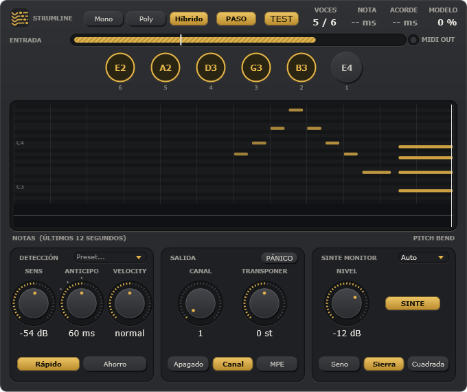

# Strumline

**English** · [Español](README.es.md)

Guitar to MIDI: a plug-in that listens to an ordinary electric guitar and plays the notes it hears (polyphonic, in real time) as MIDI.
Born as an idea for [Schematic Amp Sim](../SchematicAmpSim) (the plug-in is a separate one, see the plan) and kept in its own folder.

**The plan, the decisions and the results of each phase are in [docs/PLAN_GUITAR_MIDI.md](docs/PLAN_GUITAR_MIDI.md).**

Logo: `docs/logo/strumline-icon.svg` (ícono con fondo) y `strumline-mark.svg` (solo la marca), prompts en `docs/LOGO_PROMPT.md`.

Languages: English, Spanish, Portuguese, Italian, Chinese, French, German, Japanese, Russian and Korean (chosen in the corner of the MONITOR panel, or Auto = the system language). The translations are not reviewed by native speakers.

Status: the plug-in plays **single notes** (about 30-40 ms after the pluck, with pitch bend) and **chords** (Basic Pitch through ONNX Runtime, on its own thread: about 80-100 ms, see the plan for the numbers and the CPU cost). Modes: Mono, Poly (chords only) and Hybrid (the first note fast, the rest of the chord later). It needs `onnxruntime.dll` next to the plug-in (not in the repository, see the plan); without it Poly and Hybrid play as Mono. The TEST button plays a built-in arpeggio and chord to try the MIDI output without a guitar.



## What is here

| Path | What |
|---|---|
| `docs/PLAN_GUITAR_MIDI.md` | the plan: goal, why it is hard, the options, the architecture, the phases, the risks, the decisions taken |
| `tools/bp_eval.py` | phase 0 measurement: how good Spotify's Basic Pitch is on GuitarSet when it may only look a few frames into the future (live use) |
| `plugin/` | **Strumline**, the plug-in (VST3 and standalone): `StrumlineProcessor` (parameters, MIDI out, test script), `StrumlineEditor` (the interface), `strumline_shot` (a picture of the editor), `strumline_check` (checks the MIDI and the synth without a host) |
| `engine/` | JUCE-free parts: `pitch_detector.h` and `mono_transcriber.h` (the converter for one note), `basic_pitch.h`, `poly_worker.h` and `note_merger.h` (the chord converter: Basic Pitch via ONNX Runtime, its thread, and the merge with the one-note converter; the model is in `models/`), `note_bus.h` (the notes from the audio thread to the editor), `monitor_synth.h` (a six-voice monitor synth) |
| `probe/` | *SAS MIDI Probe*, a throw-away VST3 effect that plays a C major arpeggio as MIDI, to see if a host (REAPER) routes the MIDI of an audio effect to a synth |
| `results/` | the tables the measurements wrote |

## Running the measurement

The audio and the annotations are not in the repository (GuitarSet, CC BY 4.0, [zenodo.org/records/3371780](https://zenodo.org/records/3371780): `audio_mono-mic.zip`
and `annotation.zip`). On this machine they are in `C:\Users\Nico\Documents\SAS-datasets\guitarset`, with a Python virtual environment next to them
(`C:\Users\Nico\Documents\SAS-datasets\venv`: `onnxruntime`, `numpy` and `basic-pitch` installed with `--no-deps`, for its `nmp.onnx`).

```bat
C:\Users\Nico\Documents\SAS-datasets\venv\Scripts\python.exe tools\bp_eval.py --guitarset C:\Users\Nico\Documents\SAS-datasets\guitarset ^
    --files 8 --seconds 10 --lookahead 0 3 6 10 15 --threads 8 --out results\bp_eval.txt
```

## Building the plug-in

```bat
build.cmd target Strumline_VST3          :: the VST3, in build\plugin\Strumline_artefacts\Release\VST3
build.cmd target Strumline_Standalone    :: the standalone application (its settings window has a MIDI output selector)
build.cmd target strumline_check         :: build\plugin\strumline_check.exe: PASS / FAIL for the MIDI, the synth and the switches
build.cmd target strumline_shot          :: build\plugin\strumline_shot.exe docs\interface.png: a picture of the editor
build.cmd target strumline_eval          :: build\plugin\strumline_eval.exe <folder> [seconds]: the converter against GuitarSet recordings (tools\extract_guitarset.py makes the folder)
```

The TEST button plays an A minor arpeggio and a chord of five notes in a loop, so the MIDI output can be tried in a host (REAPER: put a synth after Strumline on
the same track, or send the MIDI to another track). THRU lets the guitar go on to the output so Strumline can sit first in a chain.

## Linux and macOS

The code is written for Windows, macOS and Linux (JUCE, plus the engine in `engine/`, which uses only standard C++). **Windows is the one tried by hand**; the other two
are checked by the GitHub Actions workflow `.github/workflows/ci.yml` (it builds all three and runs `strumline_check` on every push) and packaged by `release.yml` when a tag is pushed.

```sh
cmake -P tools/fetch_onnxruntime.cmake third_party/onnxruntime     # ONNX Runtime for the chord converter (about 184 MB download; keeps the part for each system)
STRUMLINE_ORT_DIR=$PWD/third_party/onnxruntime ./build.sh          # the same targets as build.cmd; ./build.sh target Strumline_VST3
```

- **Linux:** JUCE needs ALSA, FreeType, fontconfig and the X11 development packages (the list is in the workflow). The VST3 goes in `~/.vst3/`.
- **macOS:** ONNX Runtime 1.32 (the NuGet package) ships only the Apple-silicon (arm64) library, so on an Intel Mac the chord converter is left out (Mono only) until a build for x86_64 is added. The VST3 goes in `~/Library/Audio/Plug-Ins/VST3/`. ONNX Runtime's `libonnxruntime.dylib` is copied inside the bundle (`Contents/MacOS`). The build is for the architecture of
  the machine (arm64 or x86_64), not a universal binary; a copy that is passed on needs code signing and notarization, or macOS blocks it. No Audio Unit yet.
- **Windows:** the VST3 goes in `%LOCALAPPDATA%\Programs\Common\VST3`, with `onnxruntime.dll` next to `Strumline.vst3`.
- Without ONNX Runtime the plug-in still builds and works as the one-note converter (Poly and Hybrid play as Mono, and the interface says so).

## Building the probe plug-in

```bat
build.cmd target SasMidiProbe_VST3
```

The bundle ends up in `build\probe\SasMidiProbe_artefacts\Release\VST3`. JUCE (8.0.16-security) is taken from `..\SchematicAmpSim\third_party\juce-src` when it is
there, and fetched otherwise. Requires the Visual Studio 2022 Build Tools, like Schematic Amp Sim.

## Licences of what the plan uses

Basic Pitch (code and weights): Apache 2.0. GuitarSet: CC BY 4.0 (cite Xi et al., ISMIR 2018). RTNeural: BSD-3. JUCE: AGPLv3, like Schematic Amp Sim.
